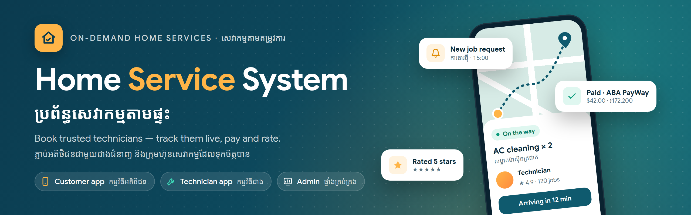
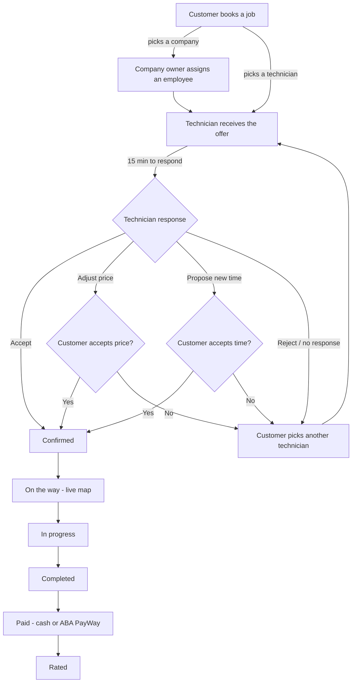
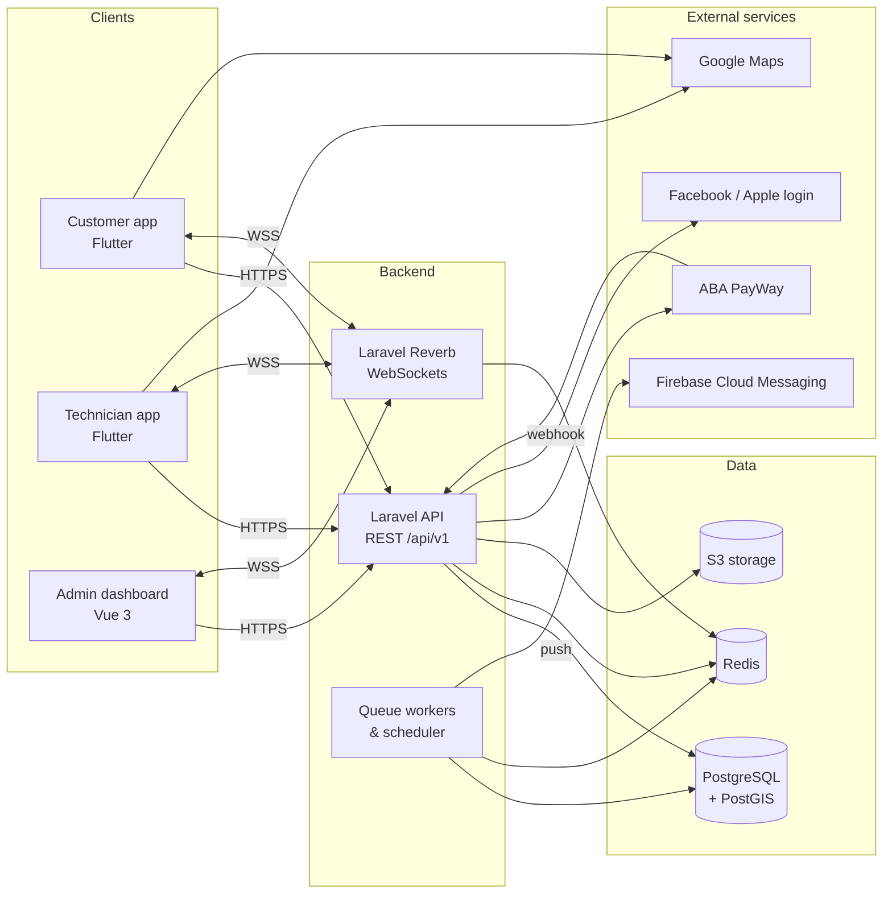

<p align="center">
  
</p>

# Sevakam

**Sevakam** (សេវាកម្ម, "service") is a mobile marketplace that connects people who need home services — repairs, cleaning, installation, maintenance — with trusted independent technicians and service companies, operated through a web admin dashboard.

> **Status:** Proposal & design complete, implementation starting (milestone M0). See [Documentation](#documentation).
>
> **Website:** [sevakam.vercel.app](https://sevakam.vercel.app) · **Repository:** [github.com/HELMAB/sevakam](https://github.com/HELMAB/sevakam) · **Landing page source:** [`docs/index.html`](docs/index.html)

---

## 1. Problem

- Finding a reliable technician usually means asking around, calling several people and negotiating price and time by phone.
- Customers have no visibility of price, arrival, or quality before the job.
- Independent technicians and small service companies lack a channel to receive jobs, manage their staff and build a reputation.

## 2. Proposed solution

Two mobile apps and an admin dashboard on a shared backend:

| Product | For | Purpose |
| ------- | --- | ------- |
| **Customer app** (iOS / Android) | Households & businesses | Find a service, book a company or technician, agree on price and time, track the job live, pay, and rate. |
| **Technician app** (iOS / Android) | Freelancers, company owners, employees | Receive jobs in real time, accept / adjust price / propose time, run the job, manage employees and promotions. |
| **Admin dashboard** (web) | Platform operators | Approve technicians, manage services and prices, monitor jobs, configure rules, settle payments, view reports. |

## 3. Users & roles

| Role | Highlights |
| ---- | ---------- |
| Customer | Books services, manages addresses, pays by cash or ABA PayWay, earns and redeems loyalty points, rates technicians. |
| Freelancer technician | Registers with certificates/patent, approved by admin, sets service area, working hours and offered services. |
| Company owner | Registers a company, creates employee accounts, assigns incoming company jobs, can also take jobs. |
| Company employee | Created by the owner; receives jobs directly or by assignment. |
| Admin | Approvals, catalog & base prices, promotions moderation, settings, reports, settlements. |

## 4. Key features

**Booking**
- Browse main services → subservices (several per job, each with quantity), or start from a top company.
- Choose a company (owner assigns an employee), one of the top 5 technicians, or the nearest technicians on a map.
- Photos, remark, address and appointment time (scheduled ≥ 1 h ahead, inside the provider's working hours).
- Transparent estimate from admin-set base prices, with promotions applied; shown in USD and KHR.

**Job lifecycle**
- Technician responds within **15 minutes**: accept, adjust price, propose a new time, or reject with a reason.
- Customer accepts or declines proposals; if declined, rejected or expired, they pick another technician.
- Live status: confirmed → on the way (**live location on a map**) → in progress → completed.
- Free cancellation until 2 hours before a confirmed appointment; appointment reminders for both sides.

**Payment, loyalty & trust**
- Pay after completion by **cash** or **ABA PayWay**; no platform commission, payouts settled by admin.
- Loyalty points for customers (redeem as a discount) and technicians (redeem for rewards); points expire after 12 months.
- Ratings with stars, photos and reasons; ranking combines Bayesian average rating with acceptance rate.

**For providers**
- Online/offline status with full-screen incoming-job alerts (push + realtime).
- Promotions (% off subservices), approved by admin and pushed to all customers.
- Company tools: employee accounts, job assignment, job history, online/offline history.

## 5. How a job works



## 6. Architecture & technology

| Layer | Technology |
| ----- | ---------- |
| Backend API | Laravel 13 (PHP 8.3), Sanctum auth, REST `/api/v1` |
| Database | PostgreSQL 16 + PostGIS (geospatial search for nearby providers) |
| Realtime | Laravel Reverb (WebSockets), Redis queues & scheduler |
| Push notifications | Firebase Cloud Messaging |
| Maps | Google Maps Platform |
| Payments | ABA PayWay |
| Mobile apps | Flutter — Riverpod, go_router, dio |
| Admin dashboard | Vue 3 + TypeScript, shadcn-vue, Tailwind CSS, Pinia |
| File storage | S3-compatible object storage |



## 7. Scope

**In v1:** everything above, English UI (i18n-ready), cash + ABA PayWay, Facebook/Apple/email login.
**Out of v1:** platform commission, additional languages, in-app chat, automatic payouts, SMS verification.

## 8. Roadmap

| Milestone | Deliverable |
| --------- | ----------- |
| M0 Foundation | Infrastructure, authentication, app & admin skeletons, CI |
| M1 Catalog & onboarding | Services/prices, technician & company registration and approval, employees, customer profile & addresses |
| M2 Booking core | Provider search, booking, assignment, proposals, reassignment, cancellation, job tracking |
| M3 Realtime & notifications | Incoming-job popup, live status, push notifications, appointment alerts, live location |
| M4 Payment & loyalty | Cash + ABA PayWay, points, ratings, ranking |
| M5 Promotions & rewards | Provider promotions with admin approval, technician rewards |
| M6 Admin operations | Job/user management, moderation, settlements, dashboard & reports |
| M7 Release | Social login, security review, hosting, App Store / Play Store release |

Detailed, ordered tasks: [`docs/tasks/README.md`](docs/tasks/README.md).

## 9. Open items

Minimum iOS/Android versions · launch date & MVP scope · hosting provider · ABA PayWay merchant account · Firebase & Google Maps keys · terms & privacy policy · domain table name (`jobs` vs `bookings`). Tracked in [`docs/spec/10-testing-delivery.md`](docs/spec/10-testing-delivery.md#104-remaining-open-items).

---

## Documentation

| Folder | Contents |
| ------ | -------- |
| [`docs/pr/`](docs/pr/README.md) | Project requirements — roles, job lifecycle, business rules, per-app requirements, decisions |
| [`docs/spec/`](docs/spec/README.md) | Technical specification — architecture, data model, state machine, API, realtime, pricing/points/payment, app screens. Includes the original `Home Service Mobile.xlsx` |
| [`docs/tasks/`](docs/tasks/README.md) | 125 implementation tasks grouped by spec, with milestone order |

## Repository structure

| Directory | Description |
| --------- | ----------- |
| `api/` | Laravel backend API |
| `admin/` | Vue 3 admin dashboard |
| `app/customer_app/` | Flutter customer app |
| `app/technician_app/` | Flutter technician app |
| `docs/` | Requirements, specification, tasks |

## Getting started

Prerequisites: PHP 8.3+ & Composer, Node.js & npm, Flutter SDK (stable), PostgreSQL 16 + PostGIS, Redis.

```bash
# API
cd api
composer setup      # install deps, create .env, generate key, migrate, build assets
composer dev        # start the dev server
composer test       # run tests

# Admin dashboard
cd admin
npm install
npm run dev

# Mobile apps
cd app/customer_app      # or app/technician_app
flutter pub get
flutter run
```

Copy `api/.env.example` to `api/.env` and adjust values (`composer setup` does this automatically). Never commit `.env` files.
